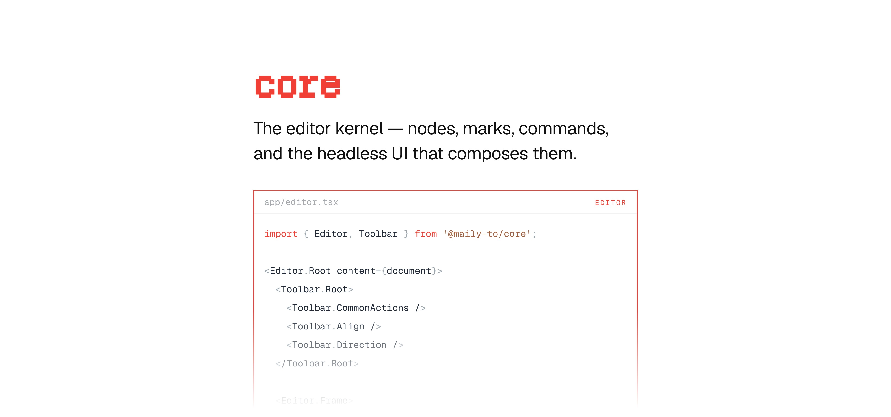

[](https://maily.to)

<p align="center">
  <a href="https://github.com/arikchakma/maily.to/blob/main/LICENSE">
    
  </a>
  <a href="https://maily.to">
    	
  </a>
</p>

### Installation

```bash
pnpm add @maily-to/core

# for types
pnpm add -D @tiptap/core
```

### Quick Start

The editor uses a **compound component** pattern — compose `Editor.Root`,
`Editor.Frame`, and `Editor.Content` to build your layout.

```tsx
import '@maily-to/core/style.css';

import { useState } from 'react';
import { Editor } from '@maily-to/core';
import type { Editor as TiptapEditor } from '@tiptap/core';

function App() {
  const [editor, setEditor] = useState<TiptapEditor>();

  return (
    <Editor.Root
      content={defaultContentJson}
      onCreate={({ editor }) => setEditor(editor)}
      onUpdate={({ editor }) => setEditor(editor)}
    >
      <Editor.Frame>
        <Editor.Content />
        <Editor.BubbleMenus />
        <Editor.DragContextHandle />
      </Editor.Frame>
    </Editor.Root>
  );
}
```

#### Editor Components

| Component                  | Description                                                            |
| -------------------------- | ---------------------------------------------------------------------- |
| `Editor.Root`              | Top-level provider. Accepts content, extensions, and editor callbacks. |
| `Editor.Frame`             | Renders the document's body and container shells.                      |
| `Editor.Content`           | Renders the Tiptap editor.                                             |
| `Editor.BubbleMenus`       | Renders every node and text bubble menu.                               |
| `Editor.DragContextHandle` | Renders the drag handle and its context menu.                          |

`Editor.Content` renders only the editor. Compose `Editor.BubbleMenus` and
`Editor.DragContextHandle` beside it to get Maily's chrome, and leave them out
for a bare canvas.

#### Reading the document

Pass a `ref` to `Editor.Root` to reach the editor and its content from outside.

```tsx
import { useRef } from 'react';
import { Editor } from '@maily-to/core';

function App() {
  const editorRef = useRef<Editor.Root.Handle>(null);

  const save = () => {
    const json = editorRef.current?.getJSON();
    // ...
  };

  return <Editor.Root ref={editorRef}>{/* ... */}</Editor.Root>;
}
```

`Editor.Root.Props` types the props in the same way.

| Method          | Returns                          |
| --------------- | -------------------------------- |
| `getEditor`     | The underlying Tiptap `Editor`   |
| `getJSON`       | The document as a `DocumentNode` |
| `getEditorHTML` | The editor's HTML                |
| `getText`       | The document's plain text        |

### Toolbar

A composable toolbar with pre-built action buttons:

```tsx
import { Editor, Toolbar } from '@maily-to/core';

<Editor.Root content={content}>
  <Toolbar.Root>
    <Toolbar.CommonActions />
  </Toolbar.Root>
  <Editor.Frame>
    <Editor.Content />
    <Editor.BubbleMenus />
  </Editor.Frame>
</Editor.Root>;
```

Or pick individual buttons:

```tsx
<Toolbar.Root>
  <Toolbar.Group>
    <Toolbar.Undo />
    <Toolbar.Redo />
  </Toolbar.Group>
  <Toolbar.Group>
    <Toolbar.Bold />
    <Toolbar.Italic />
    <Toolbar.Underline />
    <Toolbar.Strikethrough />
    <Toolbar.Code />
  </Toolbar.Group>
  <Toolbar.Align />
  <Toolbar.Direction />
</Toolbar.Root>
```

| Component                                                          | Description                                             |
| ------------------------------------------------------------------ | ------------------------------------------------------- |
| `Toolbar.Root`                                                     | Toolbar container with tooltip provider                 |
| `Toolbar.Group`                                                    | Visual grouping for buttons                             |
| `Toolbar.CommonActions`                                            | Pre-configured group with all common formatting actions |
| `Toolbar.Undo` / `Toolbar.Redo`                                    | History actions                                         |
| `Toolbar.Bold` / `Italic` / `Underline` / `Strikethrough` / `Code` | Mark toggles                                            |
| `Toolbar.Align`                                                    | Text alignment popover (left, center, right)            |
| `Toolbar.Direction`                                                | Text direction popover (LTR, RTL)                       |

### Slash Commands

Slash commands let you interact with the editor by typing `/` followed by a
command name. Commands are organized into groups with a `title` and a `commands`
array.

#### Basic Example

```tsx
import { heading1, text } from '@maily-to/core/blocks';
import { SlashCommandExtension } from '@maily-to/core/extensions';

<Editor.Root
  extensions={[
    SlashCommandExtension.configure({
      commands: [
        {
          title: 'Blocks',
          commands: [text, heading1],
        },
      ],
    }),
  ]}
>
  ...
</Editor.Root>;
```

`commands` takes groups, not blocks — every block belongs to a group with a
`title`. `DEFAULT_SLASH_COMMANDS` is the set the editor ships with, so extend it
rather than restate it when you only want to add one group.

> The order of the groups and commands determines how they are displayed in the editor.

#### Available Blocks

Import pre-built blocks from `@maily-to/core/blocks`:

**Typography:** `text`, `heading1`, `heading2`, `heading3`, `blockquote`, `hardBreak`, `clearLine`

**Layout:** `spacer`, `divider`, `section`, `columns`, `repeat`, `table`, `htmlCodeBlock`

**Content:** `button`, `image`, `inlineImage`, `linkCard`, `bulletList`, `orderedList`

**Headers:** `headerLogoWithCoverImage`, `headerLogoWithTextHorizontal`, `headerLogoWithTextVertical`

**Footers:** `footer`, `footerCommunityFeedbackCta`, `footerCompanySignature`, `footerCopyrightText`

#### Grouped Commands with Subcommands

An item with an `id` and a `commands` array becomes a nested menu. Typing
`/headers.` then shows its subcommands.

```tsx
import { heading1, heading2, heading3 } from '@maily-to/core/blocks';
import { SlashCommandExtension } from '@maily-to/core/extensions';

<Editor.Root
  extensions={[
    SlashCommandExtension.configure({
      commands: [
        {
          title: 'Blocks',
          commands: [
            {
              title: 'Headers',
              id: 'headers',
              searchTerms: ['header', 'title'],
              commands: [heading1, heading2, heading3],
            },
          ],
        },
      ],
    }),
  ]}
>
  ...
</Editor.Root>;
```

The `id` and the nesting live on the **item**, not on the group — a group only
carries a `title` and its `commands`.

> Currently supports one level of depth for subcommands.

#### Writing a Block

A block is an item with a `title`, `searchTerms`, and a `command` that runs
against the editor and the typed range.

```tsx
{
  title: 'Custom Block',
  searchTerms: ['custom'],
  command: ({ editor, range }) => {
    editor.chain().deleteRange(range).run();
  },
}
```

#### Controlling How a Block Appears

`render` decides whether an item shows and what its row looks like. Return
`null` to hide it, `true` for the default row, or JSX to replace the row.

```tsx
{
  title: 'Custom Block',
  searchTerms: ['custom'],
  command: ({ editor, range }) => {
    editor.chain().deleteRange(range).run();
  },
  render: (editor) => {
    return editor.isActive('section') ? null : true;
  },
}
```

Add `preview` to show a preview beside the row, and `description` or `icon` to
fill out the default one.

### Variables

Variables are dynamic placeholders that get replaced at render time. Typing `{{`
opens the variable picker.

#### Array of Variables

```tsx
import { VariableExtension } from '@maily-to/core/extensions';

<Editor.Root
  extensions={[
    VariableExtension.configure({
      variables: [
        { id: 'currentDate' },
        { id: 'currentTime', required: false },
        { id: 'first_name', required: false, isDefaultEditable: false },
      ],
    }),
  ]}
>
  ...
</Editor.Root>;
```

When passing an array, Maily handles query filtering automatically. A dynamic
entry is appended when no exact match exists, allowing users to create variables
on the fly.

#### Function-based Variables

For dynamic variables based on editor state, pass a function:

```tsx
VariableExtension.configure({
  variables: ({ query, editor }) => {
    // You handle filtering yourself
    return [{ id: 'notifications' }, { id: 'comments' }];
  },
});
```

### Extensions

Extensions extend the editor's functionality. Maily's own extensions are
included by default — use the `extensions` prop to configure them, to override
one, or to add an opt-in extension.

```tsx
import {
  ImageUploadExtension,
  LinkCardExtension,
  VariableExtension,
} from '@maily-to/core/extensions';

<Editor.Root
  extensions={[
    VariableExtension.configure({ variables: [...] }),
    ImageUploadExtension.configure({
      onImageUpload: async (file) => {
        const url = await uploadImage(file);
        return url;
      },
    }),
    LinkCardExtension,
  ]}
>
  ...
</Editor.Root>
```

`LinkCardExtension` is opt-in — add it to get the link card node.

#### Image Upload

Handle file drops and pastes with the `ImageUploadExtension`:

```tsx
import { ImageUploadExtension } from '@maily-to/core/extensions';

ImageUploadExtension.configure({
  onImageUpload: async (file, context) => {
    // context.position — insertion position in the document
    // context.removeImage() — call to remove the placeholder on failure
    const url = await uploadImage(file);
    return url;
  },
  onImageUploadError: (error, file, context) => {
    console.error('Upload failed:', error);
    context.removeImage();
  },
});
```

Supports `image/jpeg`, `image/png`, `image/gif`, `image/webp`, and `image/svg+xml`.

#### AI Actions and Inline Suggestions

AI transformations and ghost-text autocomplete ship inside this package. The
text bubble menu renders `AIActionsDropdown` when the AI actions extension is
present. See [extension-ai-actions](../extension-ai-actions) and
[extension-inline-suggestion](../extension-inline-suggestion).

### Theming

A document carries its own appearance. `ThemeExtension` writes a theme into the
document's `theme` attribute, and every node's `style` attribute is what the
renderer reads — so `@maily-to/render` applies no theme of its own and the email
matches the canvas.

```tsx
import { BASIC_NODE_THEME } from '@maily-to/shared';
import { ThemeExtension } from '@maily-to/core/extensions';

<Editor.Root
  extensions={[ThemeExtension.configure({ theme: BASIC_NODE_THEME })]}
>
  ...
</Editor.Root>;
```

`BASIC_NODE_THEME` is a plain starter theme. Omit `ThemeExtension`
entirely for an unthemed document — the editor stays fully usable and applies no
Maily appearance.

A theme is a `NodeThemeOptions` map from node type to an inline style:

```ts
import type { NodeThemeOptions } from '@maily-to/shared';

const theme: NodeThemeOptions = {
  body: { backgroundColor: '#ffffff', padding: '24px' },
  container: { backgroundColor: '#f9fafb', maxWidth: '600px' },
  button: { backgroundColor: '#4f46e5', color: '#ffffff' },
  link: { color: '#2563eb' },
  paragraph: { fontSize: '15px', lineHeight: '24px' },
};
```

#### Editing the theme

`ThemeSettings` gives writers a panel for the theme the document holds. Each
part edits one group of declarations.

```tsx
import { ThemeSettings } from '@maily-to/core';

<ThemeSettings.Root>
  <ThemeSettings.Font />
  <ThemeSettings.Layout />
  <ThemeSettings.Button />
  <ThemeSettings.Text />
</ThemeSettings.Root>;
```

The `setNodeTheme`, `updateNodeTheme`, and `updateShellTheme` commands do the
same work from your own UI.

## Text Direction

The editor supports LTR and RTL text directions. Set the initial direction with
the `textDirection` prop on `Editor.Root`:

```tsx
<Editor.Root textDirection="rtl">
```

Use `Toolbar.Direction` to let users toggle direction from the toolbar.

## Entry Points

| Import path                 | Contents                                                                                     |
| --------------------------- | -------------------------------------------------------------------------------------------- |
| `@maily-to/core`            | `Editor`, `Toolbar`, `ThemeSettings`, bubble menus, headless UI primitives, hooks, and types |
| `@maily-to/core/blocks`     | Pre-built slash command block items and types                                                |
| `@maily-to/core/extensions` | All Tiptap extensions and their option/storage types                                         |
| `@maily-to/core/style.css`  | Optional stylesheet — the editor works without it and carries no Maily visual styles         |

See the [@maily-to/render](../render) package for converting editor content to
HTML email templates, and [@maily-to/migration](../migration) for loading v1
documents.

### Sponsors

Sponsorship at any level is appreciated and encouraged. If you built a paid product using Maily, consider one of the [sponsorship tiers](https://github.com/sponsors/arikchakma).

<br/>

<h3 align="center">Gold</h3>

<table align="center" style="justify-content: center;align-items: center;display: flex;">
  <tr>
    <td align="center">
      <p></p>
      <p></p>
      <a href="https://novu.co?ref=maily.to">
        <picture height="60px">
          <source media="(prefers-color-scheme: dark)" srcset="https://github.com/user-attachments/assets/5e2b9ef1-5ded-4863-995d-62c7e40f946a">
          
        </picture>
      </a>
      <p></p>
      <p></p>
    </td>
  </tr>
</table>

<br/>

### License

MIT &copy; [Arik Chakma](https://x.com/imarikchakma)
