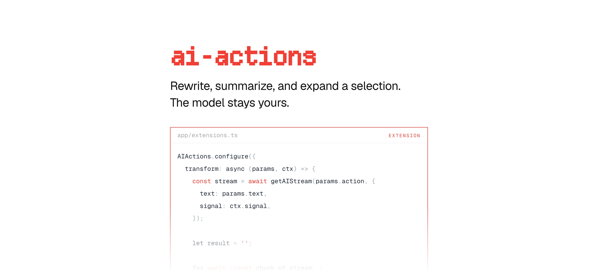

[](https://maily.to)

<p align="center">
  <a href="https://github.com/arikchakma/maily.to/blob/main/LICENSE">
    
  </a>
  <a href="https://buymeacoffee.com/arikchakma">
    	
  </a>
</p>

<br>

### Install

This package is not published on its own. It is bundled into
[`@maily-to/core`](../core), which ships the `AIActionsDropdown` the text bubble
menu renders.

```sh
pnpm add @maily-to/core
```

<br>

### Usage

The extension adds AI-powered transformations over the current selection —
rewriting, summarizing, expanding. You supply the `transform` function, so the
model and the prompt stay yours.

```ts
import { AIActions } from '@maily-to/extension-ai-actions';

const editor = new Editor({
  extensions: [
    AIActions.configure({
      transform: async (params, ctx) => {
        return getAIResult({ ctx, params });
      },
    }),
  ],
});
```

`transform` receives the action and the selected text, and returns the
replacement. State lives on the extension's storage, per editor, so two editors
on one page never share a pending action.

#### Types

```ts
import type {
  AIActionsOptions,
  AIActionsRange,
  AIActionsStorage,
  AIActionsTransformContext,
  AIActionsTransformParams,
} from '@maily-to/extension-ai-actions';
```

#### Peer dependencies

```sh
pnpm add @tiptap/core @tiptap/pm
```

### Contributions

Feel free to submit pull requests, create issues, or spread the word.

### License

MIT &copy; [Arik Chakma](https://x.com/imarikchakma)
