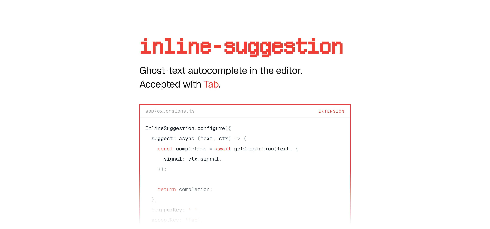

[](https://maily.to)

<p align="center">
  <a href="https://github.com/arikchakma/maily.to/blob/main/LICENSE">
    
  </a>
  <a href="https://buymeacoffee.com/arikchakma">
    	
  </a>
</p>

<br>

### Install

This package is not published on its own. It is bundled into
[`@maily-to/core`](../core) at build time.

```sh
pnpm add @maily-to/core
```

<br>

### Usage

The extension draws ghost text ahead of the caret, the way an AI autocomplete
does in a code editor. Writers accept a suggestion with `Tab`, or dismiss it by
carrying on typing.

```ts
import { InlineSuggestion } from '@maily-to/extension-inline-suggestion';

const editor = new Editor({
  extensions: [
    InlineSuggestion.configure({
      suggest: async (text) => {
        return getCompletion(text);
      },
      triggerKey: ' ',
    }),
  ],
});
```

`suggest` receives the text before the caret and returns the completion to draw.
`triggerKey` is the key that asks for one — a space in the example above.

#### Types

```ts
import type {
  InlineSuggestionOptions,
  InlineSuggestionStorage,
  SuggestContext,
} from '@maily-to/extension-inline-suggestion';
```

#### Peer dependencies

```sh
pnpm add @tiptap/core @tiptap/pm
```

### Contributions

Feel free to submit pull requests, create issues, or spread the word.

### License

MIT &copy; [Arik Chakma](https://x.com/imarikchakma)
