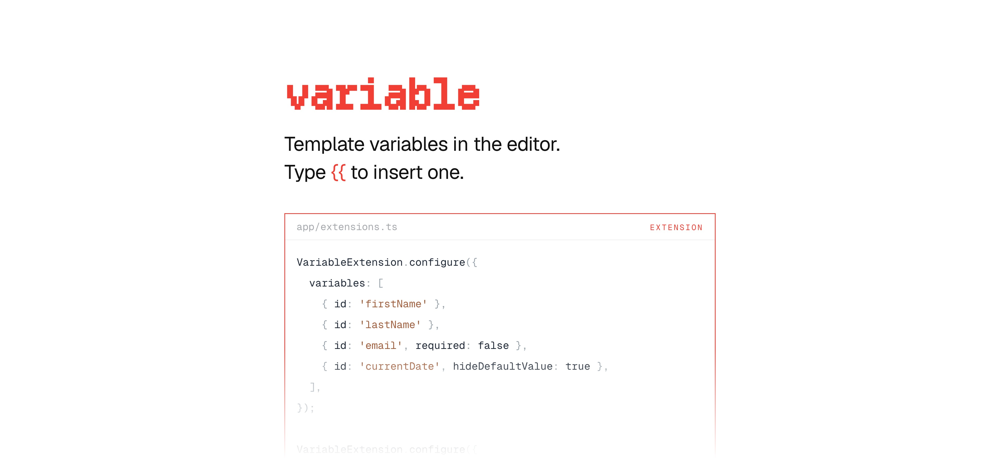

[](https://maily.to)

<p align="center">
  <a href="https://github.com/arikchakma/maily.to/blob/main/LICENSE">
    
  </a>
  <a href="https://buymeacoffee.com/arikchakma">
    	
  </a>
</p>

<br>

### Install

This package is not published on its own. It is bundled into
[`@maily-to/core`](../core) at build time, which re-exports it as
`VariableExtension`.

```sh
pnpm add @maily-to/core
```

```ts
import { VariableExtension } from '@maily-to/core/extensions';
```

<br>

### Usage

The extension adds a `variable` inline node, so writers can insert dynamic
placeholders that get replaced at render time. Typing `{{` opens the variable
picker.

```ts
import { VariableExtension } from '@maily-to/core/extensions';

const editor = new Editor({
  extensions: [
    VariableExtension.configure({
      variables: [{ id: 'currentDate' }, { id: 'firstName', required: false }],
    }),
  ],
});
```

A variable reference carries named attributes rather than a flat string, and
`@maily-to/render` resolves it from the `variables` map you pass at render time.

#### Using it directly

Configuring the underlying extension — a different trigger character, a custom
suggestion renderer — means reaching for `Variable` itself.

```ts
import { Variable, getSuggestionOptions } from '@maily-to/extension-variable';
```

#### Peer dependencies

```sh
pnpm add @tiptap/core @tiptap/pm @tiptap/suggestion
```

### Contributions

Feel free to submit pull requests, create issues, or spread the word.

### License

MIT &copy; [Arik Chakma](https://x.com/imarikchakma)
