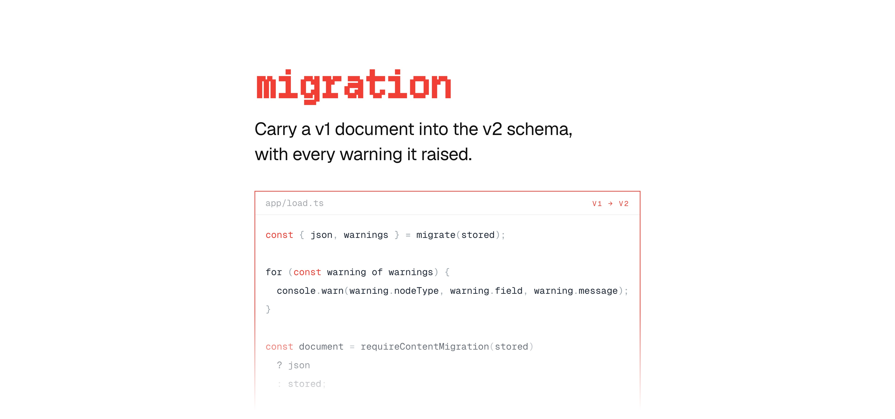

[](https://maily.to)

<p align="center">
  <a href="https://github.com/arikchakma/maily.to/blob/main/LICENSE">
    
  </a>
  <a href="https://buymeacoffee.com/arikchakma">
    	
  </a>
</p>

<br>

### Install

Install `@maily-to/migration` from your command line.

```sh
pnpm add @maily-to/migration
```

<br>

### Usage

`migrate` returns the converted document alongside the warnings it collected. It
deep-clones the input, so the original document is never mutated.

```ts
import { migrate } from '@maily-to/migration';

const v1Doc = {
  type: 'doc',
  content: [
    // ... your v1 Maily JSON
  ],
};

const { json, warnings } = migrate(v1Doc);
```

A document that is already v2 or newer is returned as-is with an empty
`warnings` array, so calling `migrate` twice is safe.

#### Warnings

A warning is emitted when a v1 attribute has no v2 equivalent and is dropped.

```ts
type MigrationWarning = {
  nodeType: string;
  field: string;
  message: string;
};
```

#### Skipping the work

`requireContentMigration` answers whether a document needs converting at all —
`true` when it carries no `version` attribute, or a `version` below 2.

```ts
import { migrate, requireContentMigration } from '@maily-to/migration';

const document = requireContentMigration(json) ? migrate(json).json : json;
```

### Where to put it

Put `migrate` at every seam where a document you did not write enters your
application — the row you load from the database, the body a client posts to
your send and preview routes. Stored documents stay on disk as v1; the seam is
what keeps an old client working.

### What it converts

The transforms cover every v1 node and mark: `showIfKey` becomes a visibility
rule, `textDirection` becomes `dir`, `textAlign` folds into the node's `style`
attribute, `is*Variable` flags become `{{name}}` references, the v1 list-marker
colour moves onto the list, and v1 column styling is converted rather than
dropped. Node ids are generated where v1 had none.

### Contributions

Feel free to submit pull requests, create issues, or spread the word.

### License

MIT &copy; [Arik Chakma](https://x.com/imarikchakma)
