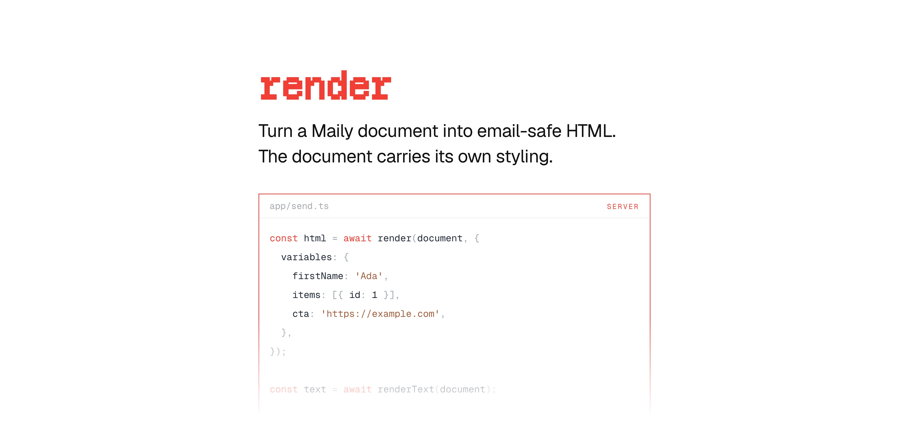

[](https://maily.to)

<p align="center">
  <a href="https://github.com/arikchakma/maily.to/blob/main/LICENSE">
    
  </a>
  <a href="https://buymeacoffee.com/arikchakma">
    	
  </a>
</p>

<br>

### Install

Install `@maily-to/render` from your command line.

```sh
pnpm add @maily-to/render
```

<br>

### Getting started

Convert Maily editor JSON into an HTML string.

```ts
import { render } from '@maily-to/render';

const html = await render({
  type: 'doc',
  content: [
    {
      type: 'paragraph',
      content: [
        {
          type: 'text',
          text: 'Hello World!',
        },
      ],
    },
  ],
});
```

A document is normalised into a body and a container before it renders, so a
bare list of blocks and a full `doc > body > container` tree both produce the
same email.

#### Plain text

`renderText` walks the same document and returns the plain-text part of a
multipart email.

```ts
import { renderText } from '@maily-to/render';

const text = await renderText(doc);
```

#### Styling

The renderer applies no theme of its own. Every colour, spacing, and font comes
from the `style` attribute the document carries, so the email matches what the
editor showed. Pass `theme` only to render a document that has none of its own.

```ts
import { BASIC_NODE_THEME } from '@maily-to/shared';

const html = await render(doc, { theme: BASIC_NODE_THEME });
```

The `<head>` carries an `@font-face` rule for every family the document's style
attributes name. Add `fontFamilies` to describe a web font the document uses.

#### Variables

All user-provided data lives under a single `variables` key — string
substitution, visibility checks, repeat arrays, and link overrides.

```ts
import { render } from '@maily-to/render';

const html = await render(doc, {
  variables: {
    name: 'Alice', // string → variable substitution
    active: true, // boolean → visibility rules
    items: [{ id: 1 }], // array → repeat iteration
    cta: 'https://example.com', // string → link href override
  },
});
```

Variable resolution follows a 3-stage priority chain:

1. `item` — per-iteration data set by repeat nodes
2. `variables` — the map above
3. `variableFormatter` — fallback that produces a placeholder string

#### Config

| Option              | Description                                             |
| ------------------- | ------------------------------------------------------- |
| `variables`         | The data map described above                            |
| `variableFormatter` | Fallback for a variable the map does not resolve        |
| `theme`             | `NodeThemeOptions` for a document that carries no theme |
| `preview`           | Preview text, as a string or as Maily JSON              |
| `fontFamilies`      | Web fonts to declare in the head                        |
| `meta`              | Extra `<meta>` descriptors                              |
| `htmlProps`         | Attributes for the root `<html>` element                |
| `openTrackingPixel` | URL of a tracking pixel to append                       |

### Contributions

Feel free to submit pull requests, create issues, or spread the word.

### License

MIT &copy; [Arik Chakma](https://x.com/imarikchakma)
