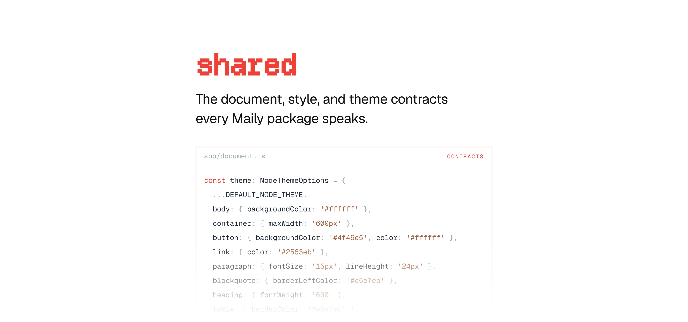

[](https://maily.to)

<p align="center">
  <a href="https://github.com/arikchakma/maily.to/blob/main/LICENSE">
    
  </a>
  <a href="https://buymeacoffee.com/arikchakma">
    	
  </a>
</p>

<br>

### Install

Install `@maily-to/shared` from your command line.

```sh
pnpm add @maily-to/shared
```

<br>

### What is in here

`@maily-to/shared` is the root package. It owns the vocabulary that
`@maily-to/core`, `@maily-to/render`, and `@maily-to/migration` all speak, and
it depends on none of them.

| Export group   | Contents                                                           |
| -------------- | ------------------------------------------------------------------ |
| Document types | `DocumentNode`, `AnyMailyNode`, node and mark attribute types      |
| Guards         | `guard<T>()`-derived type guards for every node and mark           |
| Style          | `InlineStyle` and the helpers that read and write a `style` object |
| Theme          | `NodeThemeOptions`, `BASIC_NODE_THEME`                             |
| Constants      | `MAILY_NODE_TYPES`, `MAILY_MARK_TYPES`, trigger and limit values   |

#### Documents

A Maily document is a Tiptap `doc` whose hierarchy mirrors the HTML it renders
to — `doc > body > container+ > blocks`. Authored styling lives in each node's
and mark's `style` attribute, so a document carries its own appearance and the
renderer applies no theme of its own.

```ts
import type { DocumentNode } from '@maily-to/shared';
import { BASIC_NODE_THEME, MAILY_NODE_TYPES } from '@maily-to/shared';
```

#### Themes

`NodeThemeOptions` maps a node type to an `InlineStyle`. `BASIC_NODE_THEME` is
a plain starter theme. Pass it to `ThemeExtension` to start from it, or omit it
for an unthemed document.

```ts
import { BASIC_NODE_THEME } from '@maily-to/shared';
import { ThemeExtension } from '@maily-to/core/extensions';

ThemeExtension.configure({ theme: BASIC_NODE_THEME });
```

### Contributions

Feel free to submit pull requests, create issues, or spread the word.

### License

MIT &copy; [Arik Chakma](https://x.com/imarikchakma)
